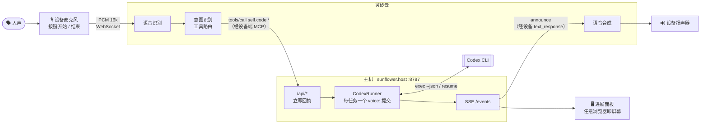
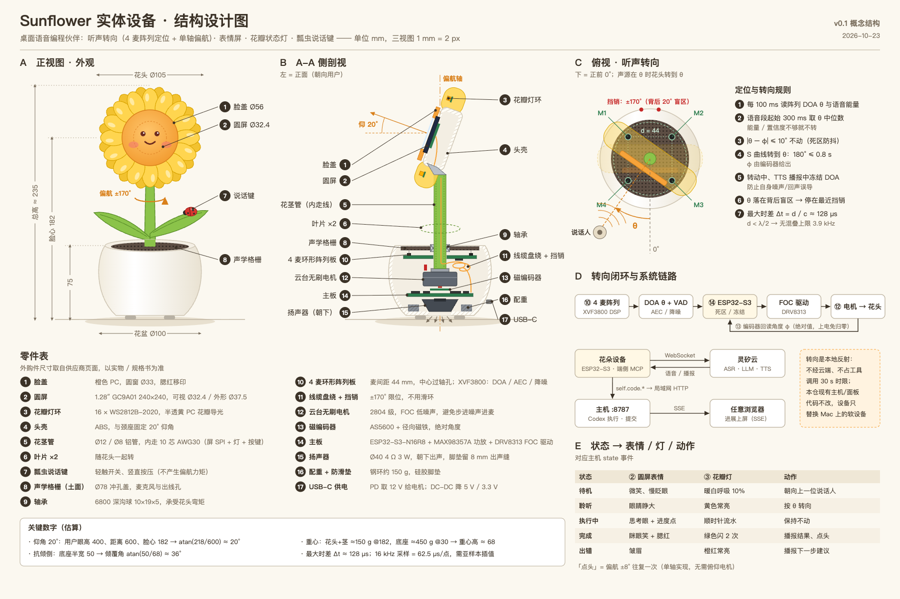

<div align="center">

# 🌻 Sunflower · 向日葵语音编程

**对着灵矽设备说一句话，Codex 就开始写代码；<br>每一步进展实时上屏，做完了用语音告诉你结果。**

[](https://www.python.org/)
[-brightgreen)](./requirements.txt)
[](https://github.com/openai/codex)
[](https://linx.qiniu.com/)
[](./LICENSE)

七牛云内部 Hackathon 参赛项目 · 议题：*灵矽应用——连接屏幕，用语音控制编程代理进行开发*（AirPlay 只是协议举例）

</div>

---

## 效果

<p align="center">
  
</p>

<p align="center"><sub>
进展面板（真实运行截图，一次完整的两轮语音会话）。先说「检查一下代码有没有逻辑问题」：Codex 跑测试，<b>红色失败</b>，只报告不改，用时 79 s。再说「给待办清单加一个删除命令，按编号删除并补上测试」，中途问「进度怎么样了？」：Codex 改代码、补测试、测试转绿、自动提交 <code>voice:</code>，播报结果，用时 103 s。
</sub></p>

<table>
<tr>
<td width="58%" valign="top">

<p align="center"><sub>设备端日志（真人语音实测）：撤销 → 派新任务 → 中途问进度 → 完成播报。<br>空闲 20 s 主动断开灵矽会话，播报时冷连接自动重连。</sub></p>
</td>
<td width="42%" valign="top">

<p align="center"><sub>同一面板在 7 寸屏（1024×600）上的布局</sub></p>
</td>
</tr>
</table>

## 它是怎么工作的



- **灵矽负责「听懂」和「说话」**：语音识别、意图识别、工具路由、TTS 都在灵矽云上；设备只上传 PCM、执行平台下发的 MCP 工具调用。
- **主机负责「干活」和「展示」**：一个进程、一个端口，同时服务设备接口、面板 SSE 和面板页面。
- **设备只做出站连接**：笔记本、另一台 Mac、树莓派都能当设备，差异只在 `profiles/*.json` 里的录音、播放、按键、主机地址四项。

### 一次语音任务的时序


## 用嘴能做的事

| 你说 | 平台路由到的工具 | 发生什么 |
|---|---|---|
| 「检查一下代码有没有逻辑问题」<br>「跑一下测试，把失败的修好」<br>「加个删除命令」 | `self.code.dispatch` | 原话交给 Codex；同一会话内的追问（「那就把它修好」）自动 `resume` 接上文 |
| 「进度怎么样了？」 | `self.code.status` | 播报当前任务、已用时间、最近一步 |
| 「停下」「别做了」 | `self.code.cancel` | 向 Codex 进程组发 SIGINT，不产生提交 |
| 「撤销刚才的改动」 | `self.code.undo` | 只回滚 `voice:` 提交（`git revert`），手写的提交不动 |

## 设计取舍

每一条都来自对灵矽平台和 Codex 的实测：

| 实测事实 | 设计 |
|---|---|
| 灵矽 `tools/call` 约 30 s 超时，晚到的结果被丢弃 | `dispatch` 立即回执，Codex 在后台跑；完成后由主机反向推送 `announce` |
| 设备侧 `text_response` 可在冷连接上逐字播报，连上到播完约 10 s | 空闲 20 s 主动断开，结果出来再连；会话时长只花在真正说话的时候 |
| 平台模型容易把「代码有没有问题」路由成查进度并反问 | 系统提示词规定「不确定就 dispatch，绝不反问代码在哪」，并附正反例 |
| ASR 会把英文标识符听成同音字 | 派发前给 Codex 加提示：原话可能有同音错字，按模糊匹配理解 |
| 语音没有「确认对话框」 | 每个任务一个 `voice:` 提交，撤销 = `git revert`，可审计、可回退 |
| 演示要可重复 | Codex 只改仓库外的一次性副本，`demo reset` 一键回到预埋 bug 的初始状态 |

**唯一的第三方依赖是 `websockets`**（无传递依赖）；HTTP、SSE、evdev 按键、进程管理全部是标准库。

## 快速开始

**环境**：macOS · Python 3.9+ · `ffmpeg`（录音 / 播放）· [Codex CLI](https://github.com/openai/codex) · 灵矽账号（[智控台](https://xrobo.qiniu.com/) 取 API Key）

```bash
git clone https://github.com/Qiniu-ERE/Sunflower.git && cd Sunflower
pip install -r requirements.txt
cp .env.example .env                 # 填 LINX_API_KEY（lx- 开头）和任意随机串 SUNFLOWER_TOKEN

python3 -m sunflower.linx_admin up   # 按需创建灵矽智能体、预注册软设备、取 WebSocket 令牌
python3 -m sunflower.demo reset      # 生成演示工作区 ~/sunflower-demo（预埋一个编号差一 bug）
```

开两个终端：

```bash
python3 -m sunflower.host   --profile dev-single-mac   # 主机：Codex 执行器 + 面板
python3 -m sunflower.device --profile dev-single-mac   # 设备：空格开始/结束说话，t 输入文字，q 退出
```

浏览器打开 <http://127.0.0.1:8787/panel>，这个页面就是屏幕。

> 不想开麦克风？`python3 -m sunflower.device --text "跑一下测试，把失败的修好"` 用文字走完整条链路。

用完清理灵矽侧资源：`python3 -m sunflower.linx_admin down`。

### 切换 Codex 渠道

渠道就是一个 Codex profile（`~/.codex/<名>.config.toml`），再加上这个渠道专属的修正参数，修正参数写在 profile 的 `host.codex_channels` 里：

```bash
python3 -m sunflower.host --profile dev-single-mac --channel icodeeasy      # 启动时选；也可设 SUNFLOWER_CODEX_CHANNEL
curl -X POST -H "Authorization: Bearer $SUNFLOWER_TOKEN" -d '{"name":"qiniu-gpt"}' \
     http://127.0.0.1:8787/api/channel                                       # 运行中切换（空闲时生效，切换后开新会话）
```

演示中上游连接不稳时，可以当场切到备用渠道。面板标题会显示当前渠道。

### 常驻服务（launchd）

```bash
python3 -m sunflower.service install      # 装成 launchd 服务：崩溃自动拉起、登录自启
python3 -m sunflower.service status       # 主机 / 部署目录 / origin/main / 设备，四个提交是否一致
python3 -m sunflower.service deploy       # 部署 origin/main 并重启；主机在执行任务时先等它结束
python3 -m sunflower.service logs
```

主机从部署目录 `~/.sunflower/app` 启动，这个目录固定在某个 main 提交上，开发仓切分支不影响正在跑的服务。`scripts/merge.sh` 合入后会自动执行 `deploy --wait 0`：主机忙时跳过，不打断任务。密钥不写进 plist，需要环境变量的渠道用 `--keychain-env VAR=钥匙串服务名` 在启动时从钥匙串注入。

## 屏幕：任意浏览器

议题里的 AirPlay 只是举例。Sunflower 的屏幕协议是 **HTTP + SSE**：面板是一个零依赖的网页，订阅主机的 `/events` 事件流，所以任何能开浏览器的屏幕都能接入，不需要专门的接收端。

| 接入方式 | 做法 | 适合 |
|---|---|---|
| 本机浏览器 | 打开 `http://127.0.0.1:8787/panel` | 开发、笔记本直连投影仪 |
| 局域网里的任意屏幕 | profile 的 `bind` 设为 `0.0.0.0`，在电视、平板、另一台电脑或树莓派上打开 `http://<主机 IP>:8787/panel?t=<SUNFLOWER_TOKEN>` | 现场大屏、设备自带屏 |
| AirPlay 镜像 | 本机面板全屏后，用 macOS「控制中心 → 屏幕镜像」投到 Apple TV 或打开了「AirPlay 接收器」的 Mac | 场地只有 AirPlay 接收端时 |

事件流只读；本机访问不需要令牌，其他机器访问需要 `?t=<SUNFLOWER_TOKEN>`。面板按 1080p 大屏和 7 寸屏自适应排版，刷新时回放最近 300 条事件，所以中途接入的屏幕也能看到完整上下文。

## 部署形态

| profile | 设备 | 主机 + Codex | 屏幕 |
|---|---|---|---|
| `dev-single-mac` | 同一台 Mac | 同一台 Mac | 本机浏览器（可 AirPlay 镜像） |
| `demo-two-mac` | Mac B（扮演带屏设备） | Mac A | Mac B 浏览器打开面板 |
| `demo-pi` | 树莓派 4B + USB 会议麦 + 翻页笔 | Mac | 树莓派 HDMI 屏上的浏览器 |
| `pi-standalone` | 树莓派 4B | 树莓派（Codex arm64） | 树莓派 HDMI 屏上的浏览器 |

跨机器时设备通过 `SUNFLOWER_HOST_URL` 找到主机；面板在非本机访问时需带 `?t=<SUNFLOWER_TOKEN>`。

### 实体设备（概念设计 v0.1）



外形是一盆桌面向日葵。花盆土面下装一圈 4 麦克风阵列，负责声源定位（DOA）；花茎由盆内的云台无刷电机带动，按声源方向 θ 偏航转动，范围 ±170°，用磁编码器闭环。脸是一块 1.28″ 圆屏，用来显示表情；花瓣内藏一圈灯环，用来显示状态；叶片上的瓢虫是说话键。转向在设备本地完成，不经过云端。设备通过 WebSocket 直连灵矽，端侧 MCP 工具 `self.code.*` 把编程请求转发给主机，所以主机和面板的代码都不用改。图由 [`docs/hardware/draw_structure.py`](docs/hardware/draw_structure.py) 生成；外购件尺寸取自供应商页面，以实物为准。

## 现场演示

完整话术与真人实测耗时见 [docs/demo-script.md](docs/demo-script.md)。每次彩排前先 `python3 -m sunflower.demo reset`（工作区回到初始状态，Codex 开新会话）。

实测同一会话内连续追问，Codex 出第一步的等待越来越长：16 s → 19 s → 83 s；闲置 99 分钟后再追问，等了 161 s，其间上游流式连接断开重连 4 次，整轮 288 s。新会话同类任务整轮 44 s、无断流。

## 项目结构

```
sunflower/
├── device.py       设备：灵矽 WebSocket、录音/播放、端侧 MCP 工具、按键触发、空闲断连
├── host.py         主机：HTTP API + SSE 广播（带回放缓冲），一个端口服务三方
├── agents.py       CodexRunner：exec/resume、事件流解析、voice: 提交、撤销、语音摘要
├── linx_admin.py   灵矽平台侧：按需建删智能体、预注册设备、OTA 取令牌
├── service.py      常驻服务：launchd、部署目录、不打断任务的重启、版本漂移检查
├── demo.py         演示工作区重置（拒绝落在比赛仓内）
├── config.py       .env / profile / 运行态（~/.sunflower，600 权限）
└── web/panel.html  进展面板（1080p 投屏 / 7 寸屏自适应，零依赖）
profiles/           部署形态：硬件差异只放在这里
demo/todo-app/      演示模板（预埋 bug + AGENTS.md）
scripts/            门禁 / 合入 / 发版（gate · merge · release），树莓派整备与密钥下发
tests/              离线单测（fake_codex 回放事件流，不连云）
```

## 测试

```bash
scripts/gate.sh    # 语法 + 全部单测，最后一行 EXIT=0 为通过；本地与 CI 同一条命令
```

覆盖派发立即返回、resume、提交/撤销、失败路径、SSE、鉴权、文本脱敏，以及门禁自身的判定逻辑。

## 开发流程

需求和调研走 issue，代码走 PR，PR 过门禁才合入，发版只从绿的 main 打 tag。改动 `sunflower/` 的 PR 要写「规格：不变量 → 测试」，门禁会验证点名的测试在旧代码上失败、在新代码上通过。详见 [CONTRIBUTING.md](CONTRIBUTING.md)。

## 许可证

[MIT](./LICENSE) © 2026 Qiniu-ERE Sunflower Team
