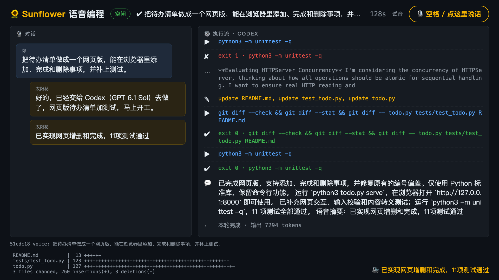
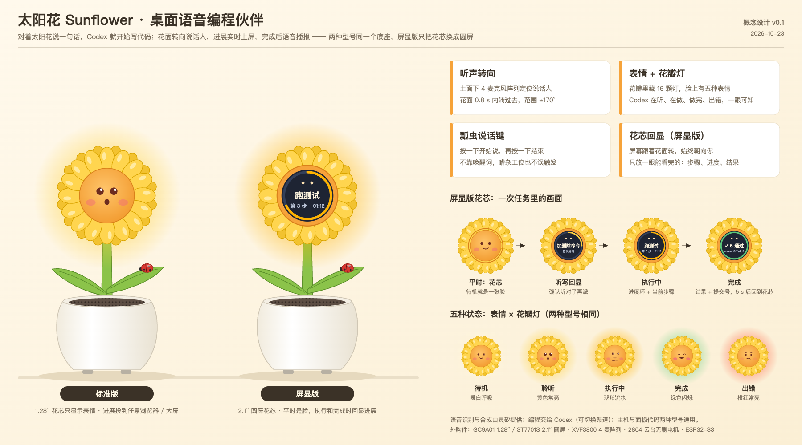
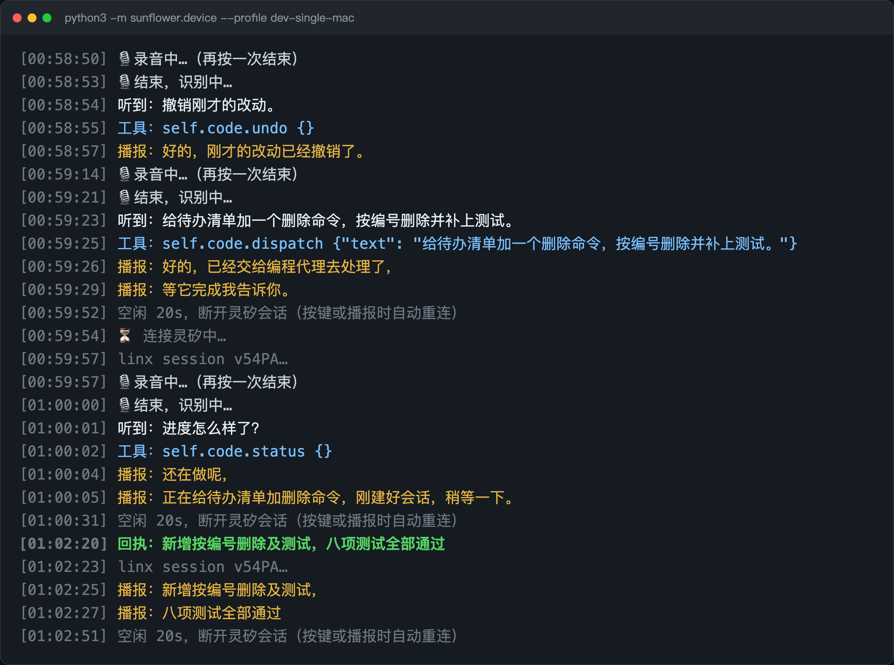
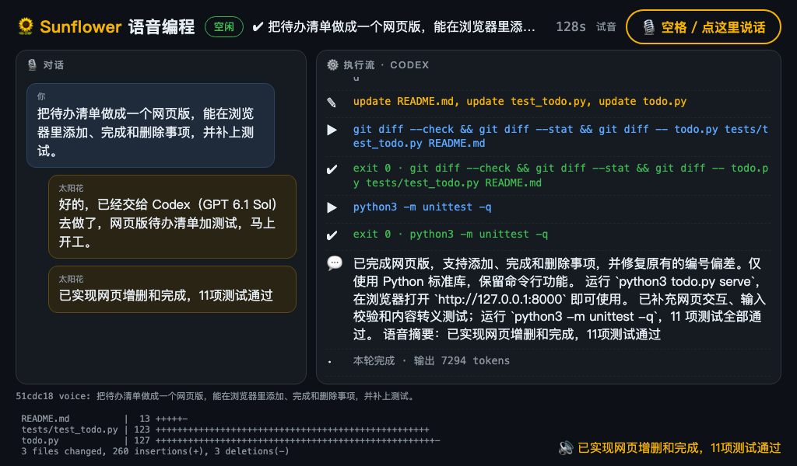
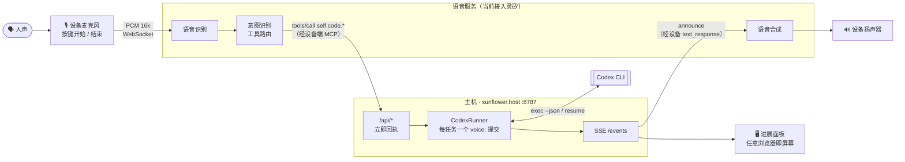
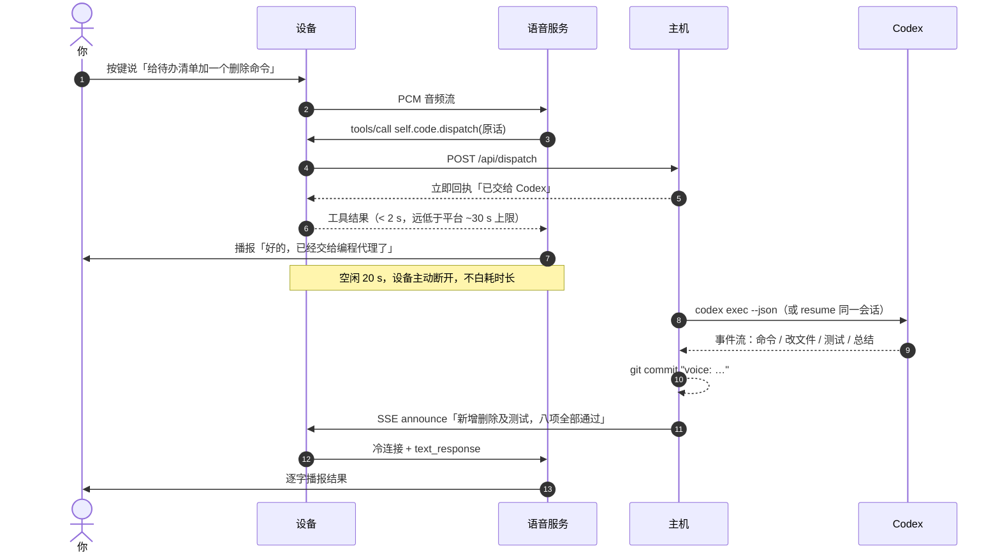
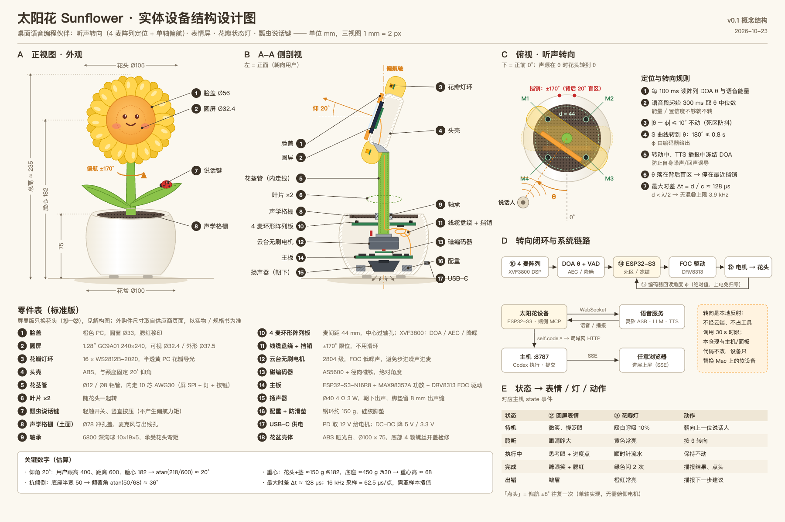
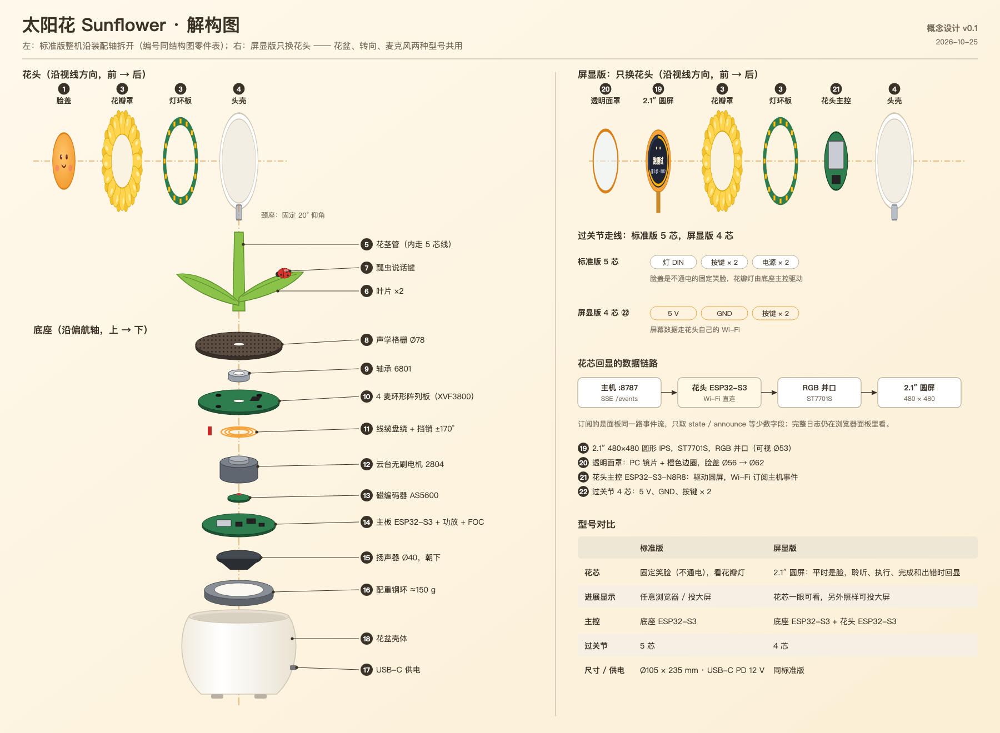

<div align="center">

# 🌻 Sunflower · 太阳花语音编程

**对着太阳花说一句话，Codex 就开始写代码。<br>花面转向说话的人，进展实时上屏，做完用语音报结果。**

[](https://www.python.org/)
[-brightgreen)](./requirements.txt)
[](https://github.com/openai/codex)
[](https://linx.qiniu.com/)
[](./LICENSE)

七牛云内部 Hackathon 参赛项目 · 议题：*灵矽应用——连接屏幕，用语音控制编程代理进行开发*（AirPlay 只是协议举例）

</div>

这个仓库有三部分：

| [软件](#软件现在就能跑) | [硬件](#硬件太阳花概念设计-v01) | [成本与竞品](#成本与竞品) |
|---|---|---|
| <a href="#软件现在就能跑"></a> | <a href="#硬件太阳花概念设计-v01"></a> | 两种型号的 BOM、亚马逊与众筹两个渠道的盈亏平衡价、众筹要多少支持者才回本，以及和 11 款亚马逊在售产品的价格与功能对比 |
| 已经能完整跑通：语音派活 → Codex 改代码 → 浏览器实时显示进展 → 语音播报结果 | 桌面摆件的概念设计，分标准版和屏显版；只做到图纸，没有打样 | 数据在 CSV 里，表格由脚本生成，改了数字重跑一次就更新 |

---

## 软件：现在就能跑

<p align="center">
  
</p>

<p align="center"><sub>
进展面板，真实运行截图，一次两轮的语音会话。第一轮说「检查一下代码有没有逻辑问题」：Codex 跑测试，<b>红色失败</b>，只报告不改，用时 79 s。第二轮说「给待办清单加一个删除命令，按编号删除并补上测试」，中途问「进度怎么样了？」：Codex 改代码、补测试、测试转绿、自动提交 <code>voice:</code> 并播报，用时 103 s。
</sub></p>

<table>
<tr>
<td width="58%" valign="top">

<p align="center"><sub>设备端日志（真人语音实测）：撤销 → 派新任务 → 中途问进度 → 完成播报。<br>空闲 20 s 断开语音会话，要播报时再连上。</sub></p>
</td>
<td width="42%" valign="top">

<p align="center"><sub>同一个面板在 7 寸屏（1024×600）上的布局</sub></p>
</td>
</tr>
</table>

### 用嘴能做的事

| 你说 | 平台路由到的工具 | 发生什么 |
|---|---|---|
| 「检查一下代码有没有逻辑问题」<br>「跑一下测试，把失败的修好」<br>「加个删除命令」 | `self.code.dispatch` | 原话交给 Codex；同一会话内的追问（「那就把它修好」）自动 `resume` 接上文 |
| 「进度怎么样了？」 | `self.code.status` | 播报当前任务、已用时间、最近一步 |
| 「停下」「别做了」 | `self.code.cancel` | 向 Codex 进程组发 SIGINT，不产生提交 |
| 「撤销刚才的改动」 | `self.code.undo` | 只回滚 `voice:` 提交（`git revert`），手写的提交不动 |

### 链路



语音识别、意图判断、工具路由和语音合成在云端的语音服务里完成，目前接的是灵矽；设备只上传 PCM 音频，再执行平台下发的 MCP 工具调用。主机是一个进程、一个端口，同时提供设备接口、面板的事件流和面板页面。设备只发起出站连接。硬件做出来之前，由笔记本、另一台 Mac 或树莓派充当设备，它们之间的差别只有 `profiles/*.json` 里的四项：录音、播放、按键、主机地址。

<details>
<summary><b>一次语音任务的时序</b></summary>



</details>

### 设计取舍

下表每一行左边都是对语音平台（灵矽）和 Codex 实测得到的结果：

| 实测事实 | 设计 |
|---|---|
| 语音平台 `tools/call` 约 30 s 超时，晚到的结果被丢弃 | `dispatch` 立即回执，Codex 在后台跑；完成后由主机反向推送 `announce` |
| 设备侧 `text_response` 可在冷连接上逐字播报，连上到播完约 10 s | 空闲 20 s 主动断开，结果出来再连；会话时长只花在真正说话的时候 |
| 平台模型容易把「代码有没有问题」路由成查进度并反问 | 系统提示词规定「不确定就 dispatch，绝不反问代码在哪」，并附正反例 |
| ASR 会把英文标识符听成同音字 | 派发前给 Codex 加提示：原话可能有同音错字，按模糊匹配理解 |
| 语音没有「确认对话框」 | 每个任务一个 `voice:` 提交，撤销 = `git revert`，可审计、可回退 |
| 演示要可重复 | Codex 只改仓库外的一次性副本，`demo reset` 一键回到预埋 bug 的初始状态 |

第三方依赖只有 `websockets` 一个，且没有传递依赖；HTTP、SSE、evdev 按键和进程管理都用标准库。

## 硬件：太阳花（概念设计 v0.1）

<p align="center">
  
</p>

太阳花是一个放在桌上的摆件。有人说话时，花面转向说话的人。Codex 正在听、在做、做完了还是出错了，看脸上的表情和花瓣灯就能知道。两种型号共用一个花盆底座，转向、麦克风和扬声器都一样；屏显版只是把花芯换成一块更大的圆屏，平时显示脸，执行和完成时显示进展。屏幕装在花面上，跟着花面转，所以总是朝着说话的人。

| | 标准版 | 屏显版 |
|---|---|---|
| 花芯 | 1.28″ 240×240，只显示表情 | 2.1″ 480×480：平时是脸，执行和完成时显示步骤、进度环、测试结果和提交号 |
| 进展显示 | 任意浏览器，或投到大屏 | 花芯上看一眼就够；完整日志仍在浏览器里 |
| 主控 | 底座一颗 ESP32-S3 | 底座同标准版，花头再加一颗 ESP32-S3，用 Wi-Fi 订阅主机事件、驱动圆屏 |
| 过转动关节的线 | 10 芯 | 4 芯（电源和按键） |
| 尺寸 / 供电 | Ø105 × 235 mm · USB-C PD 12 V | 同标准版 |

<table>
<tr>
<td width="50%" valign="top"><a href="docs/hardware/device-structure.svg"></a>
<p align="center"><sub>结构图：正视尺寸 · 侧剖视 · 俯视听声转向 · 零件表（<a href="docs/hardware/device-structure.svg">矢量版</a>）</sub></p></td>
<td width="50%" valign="top"><a href="docs/hardware/device-exploded.svg"></a>
<p align="center"><sub>解构图：标准版沿装配轴拆开，屏显版只换花头（<a href="docs/hardware/device-exploded.svg">矢量版</a>）</sub></p></td>
</tr>
</table>

听声转向的做法：土面下面装一圈 4 个麦克风，算出说话人的方向角；盆里的云台无刷电机带着花茎转过去，磁编码器做闭环，转动范围 ±170°。整个过程在设备本地完成，不经过云端。设计依据、尺寸来源和还没核实的地方见 [docs/hardware/](docs/hardware/README.md)。

## 成本与竞品

下表由 [`docs/business/cost_model.py`](docs/business/cost_model.py) 从 CSV 生成。BOM 按量产 1k 台计；有几样零件查不到 1k 档报价，只能用更小批量的价格代替，所以成本是上界。

<!-- cost_summary:begin -->
| 型号 · 渠道 | 售价 | 海外报价：落地成本 | 海外报价：盈亏平衡价 | 国内采购：落地成本 | 国内采购：盈亏平衡价 |
|---|---:|---:|---:|---:|---:|
| 标准版 · 亚马逊（建议售价） | 299.00 | 120.18 | **190.96** | 108.67 | **176.01** |
| 标准版 · 众筹（早鸟价） | 249.00 | 120.18 | **220.61** | 108.67 | **203.93** |
| 屏显版 · 亚马逊（建议售价） | 349.00 | 128.42 | **201.66** | 129.99 | **203.70** |
| 屏显版 · 众筹（早鸟价） | 289.00 | 128.42 | **232.55** | 129.99 | **234.82** |

落地成本 = 量产 1k 的 BOM ×（1 + 30% 头程与关税）；盈亏平衡价 =（落地成本 + 每台固定费用）÷（1 − 按售价提成的费用比例）。国内采购只替换查到了国内报价的零件，其余沿用海外报价。

按早鸟价 249.00 / 289.00 USD，开模方案要 1,200 / 706 名支持者才收回 NRE；自己 FDM 打印 + 自己组装要 733 / 328 名。Kickstarter 上同类先例的支持者数：ESP32 Agent Dev Kit 170、Ropet KAMOMO 1,134、Living.ai EMO 2,126、Loona 7,811、Anki Vector 8,300。
<!-- cost_summary:end -->

BOM 明细、各项费用、NRE、外壳做法（开模 / 3D 打印）对回本的影响、Kickstarter 先例、软件费率，以及竞品的价格与功能对比，见 [初期商业可行性评估](docs/business/README.md)。

## 快速开始

**环境**：macOS · Python 3.9+ · `ffmpeg`（录音 / 播放）· [Codex CLI](https://github.com/openai/codex) · 灵矽账号（[智控台](https://xrobo.qiniu.com/) 取 API Key）

```bash
git clone https://github.com/Qiniu-ERE/Sunflower.git && cd Sunflower
pip install -r requirements.txt
cp .env.example .env                 # 填 LINX_API_KEY（lx- 开头）和任意随机串 SUNFLOWER_TOKEN

python3 -m sunflower.linx_admin up   # 按需创建灵矽智能体、预注册软设备、取 WebSocket 令牌
python3 -m sunflower.demo reset      # 生成演示工作区 ~/sunflower-demo（预埋一个编号差一 bug）
```

开两个终端：

```bash
python3 -m sunflower.host   --profile dev-single-mac   # 主机：Codex 执行器 + 面板
python3 -m sunflower.device --profile dev-single-mac   # 设备：空格开始/结束说话，1–5 快捷指令，t 输入文字，m 静音，q 退出
```

浏览器打开 <http://127.0.0.1:8787/panel>，这个页面就是屏幕。

> 不想开麦克风？`python3 -m sunflower.device --text "跑一下测试，把失败的修好"` 用文字走完整条链路。

<details>
<summary><b>不方便说话时</b></summary>

嗓子哑、气短，或者需要安静的场合，下面这些方式都不用开口，或者只需少说几个字：

| 方式 | 怎么用 |
|---|---|
| 快捷指令键 | 设备终端按 `1`–`5`：检查代码 / 跑测试并修复 / 问进度 / 停下 / 撤销。小键盘和接在树莓派上的键盘（evdev）同样可用；在 profile 的 `device.quick` 里可以改成别的话 |
| 静音只上屏 | 按 `m` 切换。完成回执只显示在面板上，平台下行的语音也不放；开始和结束录音的提示音保留。profile 里写 `device.mute: true` 则启动即静音 |
| 一两个字 | 「修」「查」派给 Codex，「停」取消，「撤」撤销，「进度」查状态。改了提示词以后，要重跑一次 `linx_admin up` 才会推到平台 |
| 文字 | 按 `t` 打字，或者用 `--text` |

出错时的播报会带上下一步，例如「任务失败……可以说「再试一次」或「撤销」」。

</details>

用完清理灵矽侧资源：`python3 -m sunflower.linx_admin down`。

<details>
<summary><b>切换 Codex 渠道</b></summary>


渠道就是一个 Codex profile（`~/.codex/<名>.config.toml`），再加上这个渠道专属的修正参数，修正参数写在 profile 的 `host.codex_channels` 里：

```bash
python3 -m sunflower.host --profile dev-single-mac --channel icodeeasy      # 启动时选；也可设 SUNFLOWER_CODEX_CHANNEL
curl -X POST -H "Authorization: Bearer $SUNFLOWER_TOKEN" -d '{"name":"qiniu-gpt"}' \
     http://127.0.0.1:8787/api/channel                                       # 运行中切换（空闲时生效，切换后开新会话）
```

演示中上游连接不稳时，可以当场切到备用渠道。面板标题会显示当前渠道。

</details>

<details>
<summary><b>常驻服务（launchd）</b></summary>


```bash
python3 -m sunflower.service install      # 装成 launchd 服务：崩溃自动拉起、登录自启
python3 -m sunflower.service status       # 主机 / 部署目录 / origin/main / 设备，四个提交是否一致
python3 -m sunflower.service deploy       # 部署 origin/main 并重启；主机在执行任务时先等它结束
python3 -m sunflower.service logs
python3 -m sunflower.service device       # 在终端里从部署目录启动设备：之后每次部署，设备空闲时自己换到新代码
```

主机从部署目录 `~/.sunflower/app` 启动，这个目录固定在某个 main 提交上，开发仓切分支不影响正在跑的服务。`scripts/merge.sh` 合入后会自动执行 `deploy --wait 0`：主机忙时跳过，不打断任务。密钥不写进 plist，需要环境变量的渠道用 `--keychain-env VAR=钥匙串服务名` 在启动时从钥匙串注入。

设备不能交给 launchd：麦克风授权记在启动它的终端上。用 `service device` 启动的设备每 5 s 看一次部署目录。提交变了，就等空闲时（没在录音、播报，也没有未返回的工具调用）原地 `exec` 新代码。pid 不变，终端的麦克风授权也不变。

</details>

## 屏幕：任意浏览器

议题里的 AirPlay 只是举例。Sunflower 的屏幕协议是 **HTTP + SSE**：面板是一个零依赖的网页，订阅主机的 `/events` 事件流，所以任何能开浏览器的屏幕都能接入，不需要专门的接收端。

| 接入方式 | 做法 | 适合 |
|---|---|---|
| 本机浏览器 | 打开 `http://127.0.0.1:8787/panel` | 开发、笔记本直连投影仪 |
| 局域网里的任意屏幕 | profile 的 `bind` 设为 `0.0.0.0`，在电视、平板、另一台电脑或树莓派上打开 `http://<主机 IP>:8787/panel?t=<SUNFLOWER_TOKEN>` | 现场大屏、设备自带屏 |
| AirPlay 镜像 | 本机面板全屏后，用 macOS「控制中心 → 屏幕镜像」投到 Apple TV 或打开了「AirPlay 接收器」的 Mac | 场地只有 AirPlay 接收端时 |

事件流只读；本机访问不需要令牌，其他机器访问需要 `?t=<SUNFLOWER_TOKEN>`。面板按 1080p 大屏和 7 寸屏自适应排版，刷新时回放最近 300 条事件，所以中途接入的屏幕也能看到完整上下文。

## 部署形态

| profile | 设备 | 主机 + Codex | 屏幕 |
|---|---|---|---|
| `dev-single-mac` | 同一台 Mac | 同一台 Mac | 本机浏览器（可 AirPlay 镜像） |
| `demo-two-mac` | Mac B（扮演带屏设备） | Mac A | Mac B 浏览器打开面板 |
| `demo-pi` | 树莓派 4B + USB 会议麦 + 翻页笔 | Mac | 树莓派 HDMI 屏上的浏览器 |
| `pi-standalone` | 树莓派 4B | 树莓派（Codex arm64） | 树莓派 HDMI 屏上的浏览器 |

跨机器时设备通过 `SUNFLOWER_HOST_URL` 找到主机；面板在非本机访问时需带 `?t=<SUNFLOWER_TOKEN>`。

## 文档

| 文档 | 内容 |
|---|---|
| [docs/demo-script.md](docs/demo-script.md) | 现场演示话术与真人实测耗时；彩排前先跑 `python3 -m sunflower.demo reset` |
| [docs/hardware/](docs/hardware/README.md) | 两种型号的设计说明、关键决定与依据、尺寸来源、改图方法 |
| [docs/business/](docs/business/README.md) | 初期商业可行性评估：成本、渠道费用、盈亏平衡、外壳做法与众筹回本、众筹先例、软件费率、竞品对比；口径与数据缺口 |
| [CONTRIBUTING.md](CONTRIBUTING.md) | issue → 分支 → PR → 门禁合入的流程，以及「规格」写法 |

## 项目结构

```
sunflower/
├── device.py       设备：语音服务 WebSocket、录音/播放、端侧 MCP 工具、按键触发、空闲断连
├── host.py         主机：HTTP API + SSE 广播（带回放缓冲），一个端口服务三方
├── agents.py       CodexRunner：exec/resume、事件流解析、voice: 提交、撤销、语音摘要
├── linx_admin.py   灵矽平台侧：按需建删智能体、预注册设备、OTA 取令牌
├── service.py      常驻服务：launchd、部署目录、不打断任务的重启、版本漂移检查
├── demo.py         演示工作区重置（拒绝落在比赛仓内）
├── config.py       .env / profile / 运行态（~/.sunflower，600 权限）
└── web/panel.html  进展面板（1080p 投屏 / 7 寸屏自适应，零依赖）
profiles/           部署形态：硬件差异只放在这里
demo/todo-app/      演示模板（预埋 bug + AGENTS.md）
scripts/            门禁 / 合入 / 发版（gate · merge · release），树莓派整备与密钥下发
tests/              离线单测（fake_codex 回放事件流，不连云）
docs/hardware/      硬件概念设计：形象图 / 结构图 / 解构图（draw.py 生成）
docs/business/      成本、费率、盈亏平衡与竞品（CSV + cost_model.py 生成表格）
```

## 测试

```bash
scripts/gate.sh    # 语法检查 + 全部单测，最后一行是 EXIT=0 即通过；本地和 CI 跑的是同一条命令
```

单测覆盖：派发立即返回、resume、提交与撤销、失败路径、SSE、鉴权、文本脱敏、门禁自身的判定逻辑，以及成本表与 CSV 是否一致。

## 开发流程

需求和调研开 issue，代码走 PR，过了门禁才能合入，发版只从绿的 main 打 tag。改到 `sunflower/` 的 PR 要写「规格：不变量 → 测试」，门禁会验证点名的测试在旧代码上失败、在新代码上通过。详见 [CONTRIBUTING.md](CONTRIBUTING.md)。

## 许可证

[MIT](./LICENSE) © 2026 Qiniu-ERE Sunflower Team
