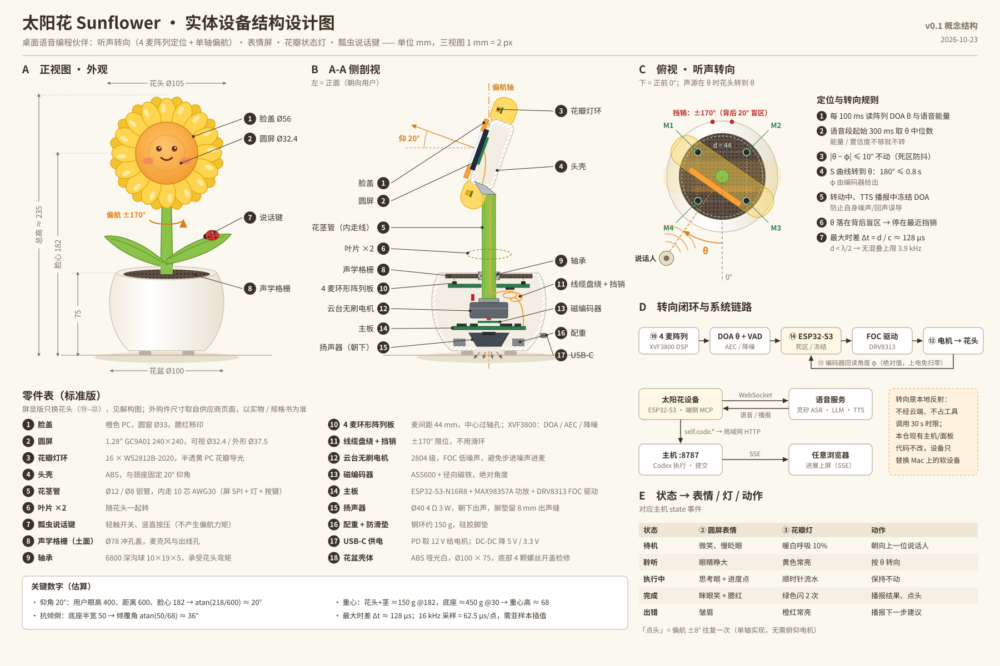
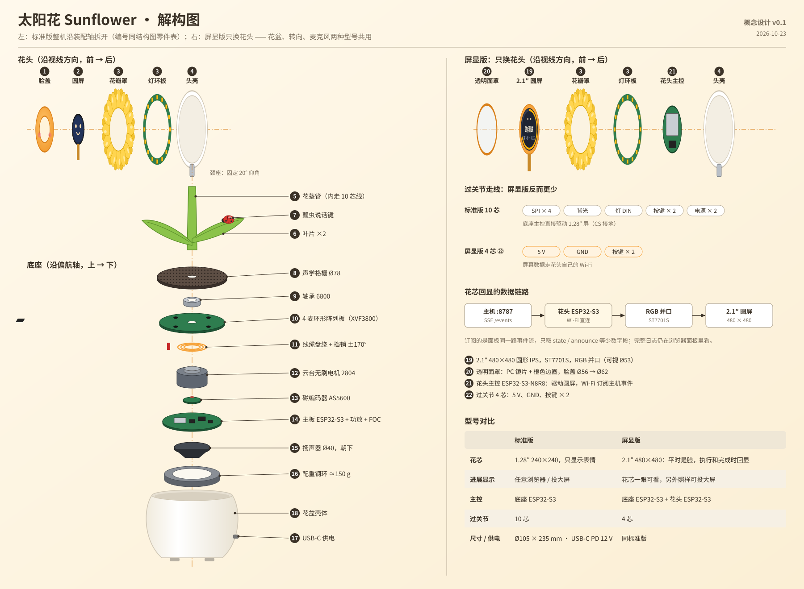

# 太阳花硬件 · 概念设计 v0.1

> 范围：这一轮只做到概念设计、成本核算和竞品对比（2026-10-23 定）。不打样，也不再往这个方向延伸；之后的精力回到软件交互和功能打磨。

太阳花是这套语音编程链路的桌面硬件载体。你说话时，花面转向你；脸上的圆屏显示表情，花瓣里的灯显示状态，叶片上的瓢虫是说话键。两种型号用同一个花盆底座，屏显版只把花芯换成一块更大的圆屏：平时是脸，执行和完成时回显进展。


## 两种型号

| | 标准版 | 屏显版 |
|---|---|---|
| 花芯 | 1.28″ GC9A01 240×240，只显示表情 | 2.1″ ST7701S 480×480，可视区约 Ø53：平时是脸，执行和完成时回显，完成 5 s 后回到花芯 |
| 进展显示 | 任意浏览器 / 投到大屏 | 花芯只显示一眼能看完的内容（步骤、进度环、测试数、提交号）；完整日志仍在浏览器面板 |
| 主控 | 底座 ESP32-S3（DOA、电机、音频，直连语音服务） | 底座同标准版；另加花头 ESP32-S3-N8R8，Wi-Fi 订阅主机 `/events`，用 RGB 并口驱动圆屏 |
| 过转动关节 | 10 芯：SPI × 4（CS 接地）、背光、灯、按键 × 2、电源 × 2 | 4 芯：5 V、GND、按键 × 2 |
| 软件 | 固件（规划中）：端侧实现 `self.code.*` 工具，转发给主机 | 同左；花头固件只订阅事件流、绘制花芯 |
| 尺寸 / 供电 | Ø105 × 235 mm · USB-C PD 12 V | 同标准版，脸盖从 Ø56 加大到 Ø62 |

**为什么把屏放在花芯上**：早先的方案是在花箱正面放一块 7″ 屏（v0.1 草稿），后来改成现在这样，理由有三条：

1. 两种型号可以共用花盆底座和转向模块；
2. 花面本来就会转向说话人，所以屏幕始终对着人；
3. 圆屏的 RGB 并口要 20 多根线，过不了转动关节。在花头里放一颗 ESP32-S3 自己连 Wi-Fi，过关节的线反而从 10 芯减到 4 芯。

代价是信息密度：53 mm 的圆面，在 60 cm 外看，一行只放得下 5 到 6 个字。所以完整日志仍然交给浏览器面板。

成本、软件费率和竞品价格见 [docs/business/](../business/README.md)。

## 结构图

正视尺寸 · A-A 侧剖视 · 俯视听声转向 · 转向闭环与系统链路 · 状态映射 · 18 项零件表。



## 解构图

左边是标准版，沿装配轴拆开：花头沿视线方向分解，底座沿偏航轴分解。右边是屏显版，只换花头：透明面罩、2.1″ 圆屏、花头主控、4 芯过关节线，编号接着结构图的零件表往下排（19–22）。



## 关键设计决定

| 决定 | 依据 |
|---|---|
| 麦克风阵列固定在花盆里，不随花头转 | DOA 直接给出底座坐标系下的角度，就是电机的目标角，不用补偿自身转动 |
| 麦间距 44 mm | 最大时差 Δt = 44 mm ÷ 343 m/s ≈ 128 μs；不混叠的上限频率 c / 2d ≈ 3.9 kHz，覆盖语音主能量 |
| 云台无刷电机 + FOC，不用步进电机 | 步进电机的噪声离麦克风只有几厘米；另外，转动中和播报中冻结 DOA |
| ±170° 挡销 + 线缆盘绕，不用滑环 | 只需 10 芯细线过关节；背后留 20° 盲区 |
| 磁编码器 AS5600 | 单圈绝对角度覆盖 ±170°，上电不用归零 |
| 花头固定上仰 20° | 用户眼高 400 mm、距离 600 mm、脸心高 182 mm：atan(218 / 600) ≈ 20° |
| 配重约 150 g，放在盆底 | 估算重心高约 68 mm，倾覆角 atan(50 / 68) ≈ 36° |
| 瓢虫键竖直按压 | 按键力不产生偏航力矩，不会把花头按转 |

## 尺寸来源与待核实

- 1.28″ GC9A01 圆屏：可视区 Ø32.4 mm，外形 Ø37.5 mm（[Waveshare](https://www.waveshare.com/1.28inch-lcd-module.htm)）
- 2.1″ 480×480 圆屏（ST7701S）：有效区 53.28 × 53.28 mm，外形 58.18 × 60.71 mm（[Newhaven](https://newhavendisplay.com/de/2-1-inch-480x480-round-ips-tft-lcd-display)）
- reSpeaker Flex XVF3800 Circular-4：直径 73 mm，麦间距 44 mm（[RobotShop](https://www.robotshop.com/products/respeaker-flex-xvf3800-circular-4-microphone-array-w-xiao-esp32s3-for-robotics-embedded-applications)、[The Pi Hut](https://thepihut.com/products/respeaker-flex-xvf3800-circular-with-xiao-esp32s3)）
- 6801ZZ 轴承：12 × 21 × 5 mm，内径配 Ø12 花茎（[minibearings](https://minibearings.com.au/products/12-21-5-bearings-ball-chrome-steel-bearing-6801zzeco)）。v0.1 初稿写的是 6800，内径 10 mm 装不进 Ø12 花茎，10-24 改正
- 待核实：现成阵列板中心没有过轴孔，需要定制环形麦克风板；重心和倾覆角要按实物重新实测

## 改图

图全部由 [`draw.py`](draw.py) 生成。改尺寸或文案时只改脚本，然后执行：

```bash
python3 docs/hardware/draw.py docs/hardware   # 生成三张 SVG
```

PNG（宽 1800）是用浏览器打开 SVG 后截图得到的，README 引用的是 PNG。
